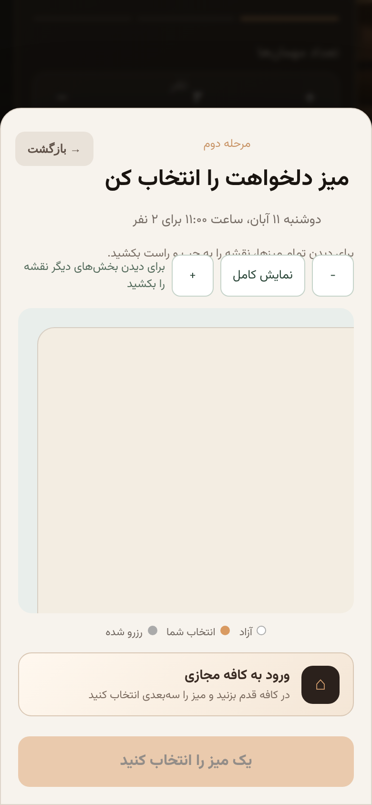
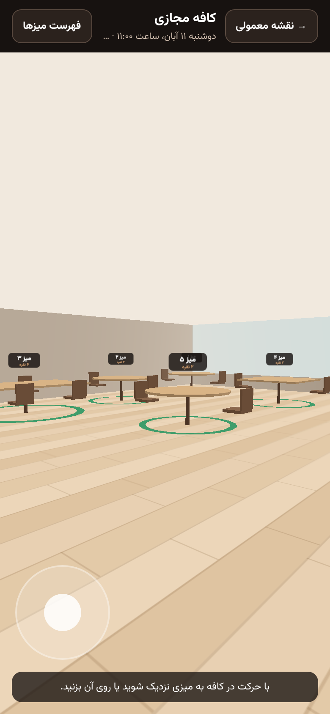
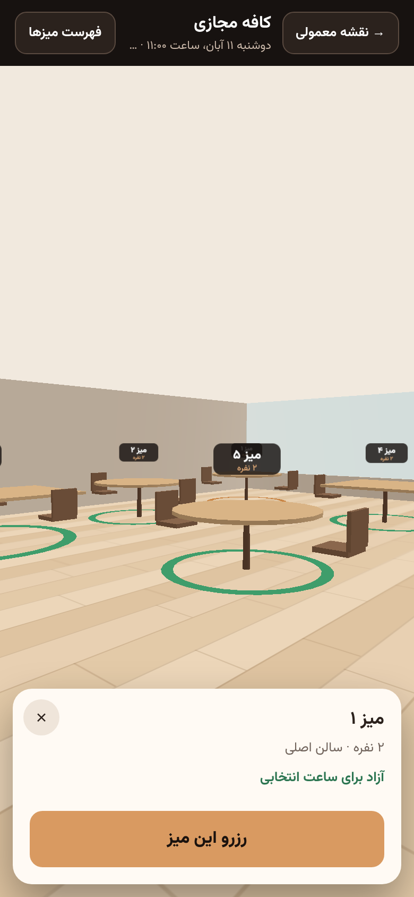
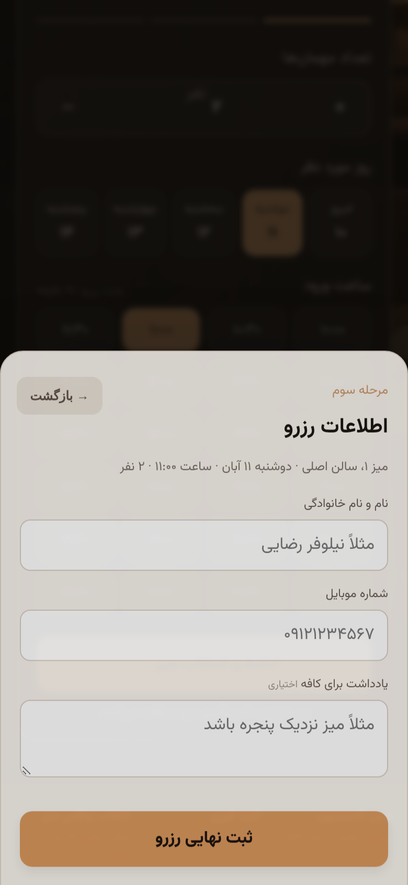
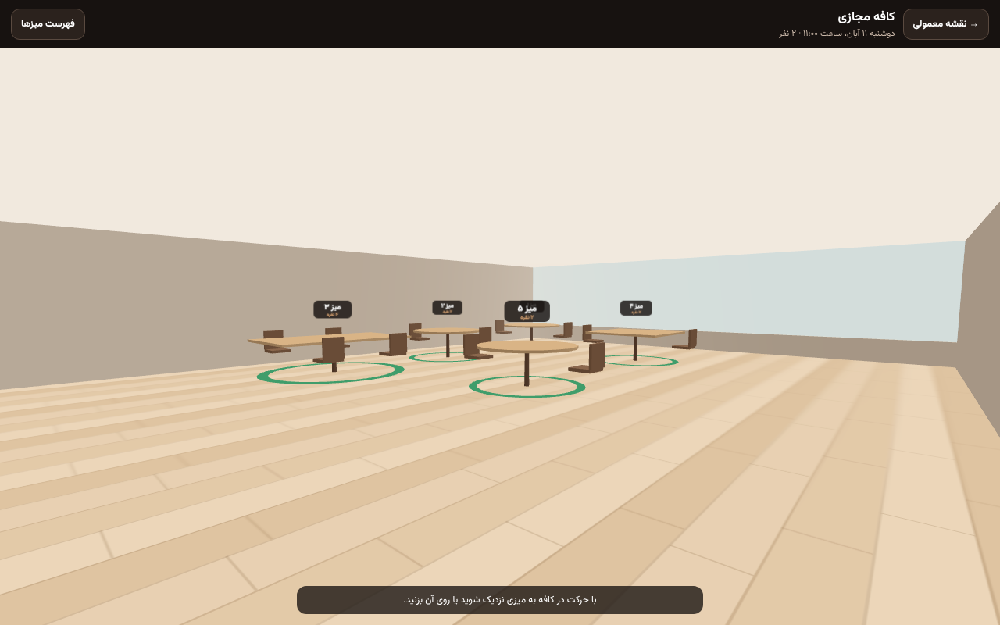
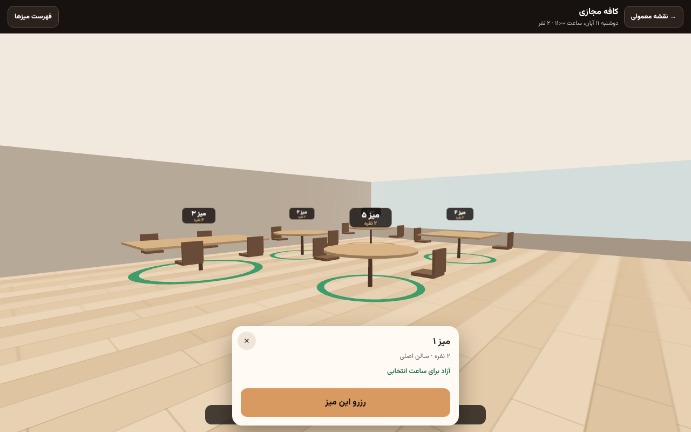

# Virtual Cafe: Phase 1 report (3D table selection prototype)

Customers can step into a 3D version of the café, walk around, look at real tables with their live availability, and pick one. The booking itself still goes through Mizo's standard form and backend.

## Turning it on

| Where | How |
| --- | --- |
| Production | Set `VIRTUAL_CAFE` to café slugs separated by commas (`VIRTUAL_CAFE=cafe-1a2b3c4d5e6f`), or to `all`. Unset keeps it off. See [configuration.md](../configuration.md) |
| Locally | `VIRTUAL_CAFE=all` in `.dev.vars`, then `npx wrangler dev` |
| Browser tests | `GET /__e2e/virtual-cafe?cafe=<slug>` on the e2e server turns it on for one café |

On a café with it on, choose a date, time and party size, press "Continue", and the table step shows **"ورود به کافه مجازی"** (enter the Virtual Cafe) under the 2D map.

## What the customer gets

```text
Table step ─► "Enter the Virtual Cafe" ─► loading screen (cancel = back to the 2D map)
   ─► walk in the café ─► tap a table, or face it and press Enter ─► card with the latest state
   ─► "Reserve this table" ─► availability read again ─► the standard details form
```

- **The scene** is built from the branch's published floor map: every area (tabs at the top when there are several), every table at its real place, shape, size and number of chairs, the counter and the full-height window where the 2D map draws them, and the door the visitor enters through. Outdoor areas get grass and a low fence instead of walls and a ceiling.
- **Moving:**
  - On a computer: W/S or ↑/↓ to walk, A/D to step sideways, ←/→ to turn, drag to look around.
  - On a phone: a thumb joystick to walk, and dragging elsewhere to look.
  - Walls, tables and the counter stop the visitor, who slides along them rather than through.
  - The camera is at eye height, with no acceleration, bobbing or blur.
- **Tables:**
  - A coloured ring on the floor shows each table's state: green for free, grey for taken, copper for the customer's choice, beige for unknown.
  - A label above each table shows its number and size.
  - The table straight ahead is named at the bottom of the screen.
  - The card shows the name, size, area, "by the window" when it is, and the state just read from the backend.
- **"Tables list":** the same tables as buttons, for screen readers, keyboard users, and anyone who prefers a list.
- **Booking:** "Reserve this table" reads availability again, then hands the table to `chooseTable()` / `continueWithTable()`, the same functions the 2D map uses. The customer fills in the usual form; date, time, party size, deposit and Jalali dates are untouched.

## Concurrency

The backend was already authoritative and atomic, so nothing was added on the client to imitate it:

1. **Before the hand-off**, the adapter reads availability again. If the table was taken while the customer looked, the card says so, the table turns grey, and the form never opens. Browser test: "a table taken while the customer looks…".
2. **On submit**, `createReservation` checks the interval again, and the triggers of `0012_tenant_booking_integrity.sql` reject an overlapping row even if two requests pass that check at once. The server log of the browser test shows the trigger firing (`reservation_overlap`).
3. **When the backend refuses** (`409`), the page refreshes availability and redraws the 2D map; reopening the Virtual Cafe shows the table taken. Browser test: "a table taken after the hand-off…".

**Gap, documented for the concurrency phase:** a table is not *held* while the customer fills in the form. Two customers can both reach the form for the same table; the second is refused at submit, as tested. A server-side `AVAILABLE → HELD → BOOKED` hold with expiry would need a new table or column, an expiry job and changes to availability, which is beyond this phase.

## Failure and fallback

| Case | What happens | Tested |
| --- | --- | --- |
| No WebGL | Detected before downloading; message and "continue with the normal map" | Browser test (WebGL disabled) |
| Engine script fails or never registers | Message, "try again" and "continue with the normal map" | Browser test (broken script) |
| Slow connection | The loading screen stays responsive; "continue with the normal map" works at once; a late download opens nothing | Browser test (held download) |
| Download over 20 s | Treated as a failure (`load_timeout`) | By design (`config.js`) |
| Crash in the frame loop, lost GPU context | The engine is freed and the fallback shown | By design (`engine/index.js`) |
| Café map without tables | Message instead of an empty room | By design |

In every case the 2D map underneath is unchanged and the booking continues.

## Performance

Details in [performance-baseline.md](performance-baseline.md). In short:

- **Normal booking:** about 6.9 KB more gzipped on first load, no engine download, no WebGL, no frame loop.
- **Opening the Virtual Cafe:** one 142 KB gzipped download (561 KB raw), interactive in 0.6 s on desktop and 1.6 s on a phone profile with the CPU slowed 4×, with about 10 MB of JS heap.
- **Scene cost:** 18–19 draw calls and about 1,000 triangles. No image textures, two lights, no shadows or post-processing.
- **Instancing:** chairs, table tops, legs and state rings are instanced, so each is one draw call however many tables there are.
- **Rendering:** the engine draws only when something changes, and steps the resolution down if frames stay slow while moving.

Frame rates were measured only on a CPU renderer (8–23 FPS). **Real phones still need measuring before release.**

## Responsive layout and accessibility

- **Screenshots** below, at desktop 1280 × 800 and phone 390 × 844. The browser tests run every scenario at desktop and Pixel 7 sizes.
- **Safe areas:** the header, hint, joystick and card respect them. The joystick shows only on touch screens (`pointer: coarse`). The card sits above the hint and leaves the back button free.
- **Reduced motion:** with it on, the loading spinner stops; the camera never animates on its own anyway.
- **Keyboard:** the canvas is focusable and labelled, and Enter picks the table ahead.
- **Fallback for everyone:** the tables list and the 2D map remain available to anyone who cannot or does not want to use 3D.

## Telemetry

`web/src/virtual-cafe/telemetry.js` dispatches `mizo:telemetry` events on `window`: `virtual_cafe_opened`, `virtual_cafe_loaded` (with load time), `virtual_cafe_load_failed` (with the reason), `virtual_table_selected`, `virtual_table_unavailable`, `virtual_booking_started`, `virtual_cafe_exited`. They carry the branch or table id and a reason or duration, never the customer's name or mobile. No analytics vendor is connected.

## Debug panel

Add `?vcdebug=1` to the URL. It shows FPS, draw calls, triangles, the scene's branch, the area, the selected table and its state. It is never shown without the parameter.

## QA scenarios

| Scenario | Result |
| --- | --- |
| A. Normal booking | Pass. Same requests, no engine, no canvas (browser test) |
| B. Enter 3D | Pass. The engine is requested only on click; interactive in 0.6–1.6 s |
| C. Select an available table | Pass. Its real full id and fresh availability are used; the booking lands on that table (browser test checks the reservation's table) |
| D. Availability changes | Pass. Refused before the hand-off and again by the backend at submit; no duplicate reservation; both maps refresh (two browser tests) |
| E. 3D failure | Pass. The fallback leads to the 2D map, and booking continues (browser test) |
| F. Slow connection | Pass. The loading screen can be left at once (browser test) |
| G. Mobile performance | Partly. Profiled on a phone viewport with CPU throttling and a software GPU. **Not yet run on real phone hardware** |

## Screenshots

| | |
| --- | --- |
|  |  |
|  |  |
|  |  |
|  | |

## Known limitations

- **Real phones:** not yet measured on real hardware (see above).
- **Scene detail:** simple shapes and colours. There are no walls between areas; each area is its own room, reached through the tabs.
- **Counter and door:** placed where the 2D map draws them (the map has no data for them), so they can overlap a table that a café placed there.
- **Tables are not held** while the customer fills in the form (see Concurrency).
- **Chosen time:** the Virtual Cafe opens from the table step, so date, time and party size are chosen first, as in the 2D flow.
- **Loading progress:** the browser cannot report progress for a script download, so the loading screen shows a spinner rather than a percentage.
- **Initial download:** the module's own UI adds about 6.9 KB gzipped to the first load of the booking page.

## Recommended before Phase 2

1. **Measure on real phones:** a mid-range Android and an iPhone, for frame rate, heat over five minutes, and load time on 4G. Adjust the adaptive-resolution threshold from the results.
2. **Server-side table hold:** a `HELD` state with expiry for the time between "Reserve this table" and submit. It needs a schema change and an expiry job.
3. **Venue data in the map:** positions for the counter, doors, windows and walls in the floor editor, so the scene, and later a scanned Digital Twin, can use real geometry instead of the 2D map's fixed decoration.
4. **Minify `app.js`:** this would more than offset the 6.9 KB this module adds.
5. **A per-branch switch in the owner's settings,** if cafés should turn the feature on themselves. It needs a column in `branch_settings`.
