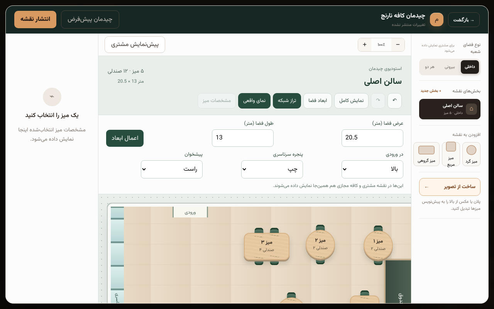
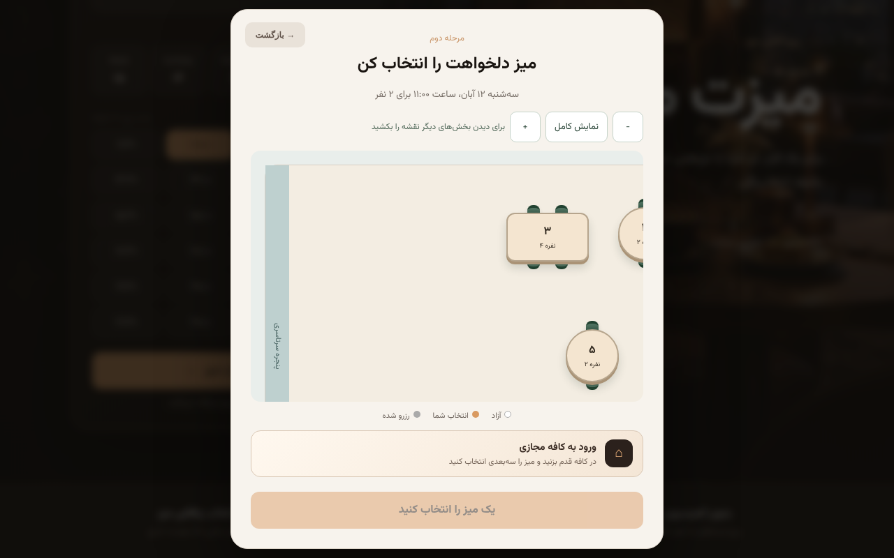
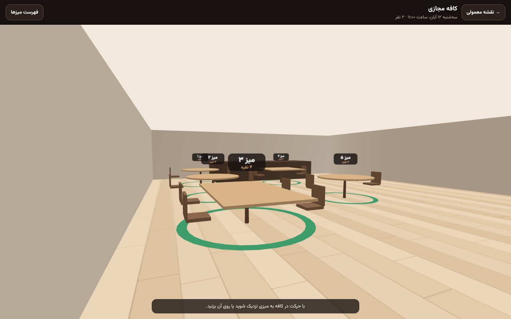
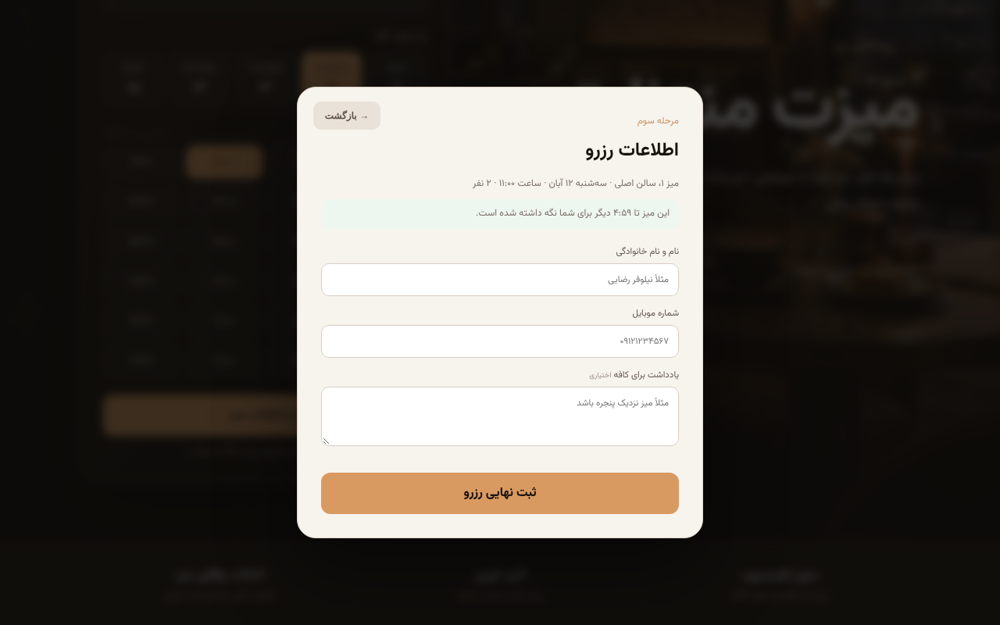

# Virtual Cafe: Phase 2 report

Phase 2 carries out the recommendations of the [Phase 1 report](phase-1-report.md) that can be built and verified here. Measuring on real phones still needs real phones.

| Recommendation | Status |
| --- | --- |
| 1. Measure on real phones | **Not done here:** this environment has no phone or GPU. See "Still to do" |
| 2. Hold the table on the server while the customer fills in the form | ✓ Done |
| 3. Door, window and counter in the map data | ✓ Done |
| 4. Minify `app.js` | ✓ Done |
| 5. A per-branch switch for the owner | ✓ Done |

## 1. Table holds (`AVAILABLE → HELD → BOOKED`)

**Problem.** In Phase 1, two customers could both reach the booking form for the same table; the second was refused only at submit.

**Now.** When the customer continues to the form, from the 2D map or from the Virtual Cafe, the server holds the table for **5 minutes**. The form shows a live countdown ("this table is held for you for 4:59").

| Who | What happens |
| --- | --- |
| The holder | Books with the hold's token; the booking uses the hold up in the same transaction |
| Anyone else, booking | Refused (`409 slot_taken`) by a database trigger, even with a direct API call |
| Anyone else, browsing | The table is not in availability, so it shows as taken on both maps |
| The holder going back | The hold is released at once (`DELETE …/holds/{id}`) |
| Nobody acting | The hold expires after 5 minutes and is ignored everywhere; the background job deletes it |

**How it is enforced** (`worker/src/holds.js`, migration `0019_virtual_cafe_phase_2.sql`):

- **Creating a hold** is one conditional `INSERT … SELECT … WHERE NOT EXISTS (overlapping live hold) AND NOT EXISTS (overlapping active reservation)`. D1 runs a statement atomically, so two customers asking at the same instant cannot both get it. A unit test fires three requests at once and gets exactly one `201`.
- **The trigger `reservation_table_held`** refuses any reservation row for a table someone else holds over an overlapping interval. The holder's booking first deletes its own hold in the same batch, so the trigger lets it through.
- **Only the holder can release or use the hold.** The token is random, and the server stores only its SHA-256 hash.
- **Abuse limits:** a client holds at most two tables of a branch at once (`429 too_many_holds`), and holds are rate limited per IP (`RATE_LIMIT_HOLDS_PER_IP_HOUR`, default 30).
- **Staff bookings** respect holds too: a walk-in on a table a customer is holding is refused for at most the remaining minutes.

## 2. Door, window and counter in the map data

**Problem.** The 2D map always drew the counter on the left wall, the window on the right and the door at the bottom, and the Virtual Cafe copied that.

**Now.**
- **Choosing:** in the map editor's "room size" panel, the owner picks the wall for the door, the full-height window (or none) and the counter (or none).
- **Storing:** each room stores the choice as `areas.layout`.
- **Drawing:** `web/src/venue-layout.js` computes the geometry once. The editor, the customer's 2D map and the 3D scene all draw from it, so the three always agree.
- **Defaults:** a room saved before this keeps the classic layout, with the same pixel positions as before. Outdoor rooms have no window or counter unless the owner adds one.
- **Conflicts:**
  - A window on the door's wall gives way to the door.
  - A counter on the door's wall starts past the door, so the entrance stays clear.
- **In 3D:** the door is a gap in its wall, the window wall is a sill with glass above, and visitors start just inside the door, facing the tables.

## 3. Minified `app.js`

The main bundle (and the SaaS console's) is now minified like the engine bundle.

| `/app.js` | Raw | gzip |
| --- | --- | --- |
| Before the Virtual Cafe | 185,164 | 38,203 |
| Phase 1 (not minified) | 206,170 | 43,205 |
| **Phase 2 (minified, with holds and layouts)** | **141,018** | **35,657** |

The booking page's script is now **2.5 KB gzipped smaller than before the Virtual Cafe existed**, with 44 KB less to parse. The whole first load is about 7 KB gzipped smaller than in Phase 1.

## 4. The owner's switch

- **The platform** still decides which cafés may use the Virtual Cafe (`VIRTUAL_CAFE`). Its settings answer field is now `virtualCafeOffered`.
- **Each branch's owner** can switch it off in the control centre ("کافه مجازی"). The switch is stored as `branch_settings.virtual_cafe_enabled`, on by default, and only shown where the platform offers the feature.
- **The booking page** shows the entry only when both are on.
- **Bug found while building this:** saving settings returned only the stored fields, so after a save the page lost `paymentMode`, `onlineBookingPaused` and the Virtual Cafe flags until it reloaded. A paused café briefly looked open to its owner. The save answer now carries the same computed fields as reading.

## Database and API changes

- **Migration `0019_virtual_cafe_phase_2.sql`:**
  - the `table_holds` table and the `reservation_table_held` trigger
  - `branch_settings.virtual_cafe_enabled` (default on)
  - `areas.layout` (default NULL, which means the classic layout)

  Nothing existing is changed or removed.
- **New routes:**
  - `POST /api/cafes/{cafe}/branches/{branch}/holds`
  - `DELETE /api/cafes/{cafe}/branches/{branch}/holds/{id}`

  Both are in `docs/openapi.yaml`.
- **Changed fields:**
  - Public booking accepts `holdToken`.
  - The settings answer: `virtualCafeOffered` (platform) and `virtualCafeEnabled` (owner).
  - The map's areas: `layout`.
- **New env variable:** `RATE_LIMIT_HOLDS_PER_IP_HOUR`.

## Tests

| Kind | New |
| --- | --- |
| Unit and API (`tests/table-holds.test.mjs`, `tests/virtual-cafe.test.mjs`) | Holds hide the table, block others and stay single under concurrent requests. The holder's token books, and a booking without it is refused by the trigger. Release needs the token, expiry is ignored and cleaned up, and the per-client cap, rate limit and validation hold. Also: the owner's switch survives a save; layout geometry, defaults and conflicts; a layout saved and read back clean; the 3D scene following the layout |
| Browser (`e2e/`) | The 2D form holds the table and going back releases it. In 3D, after the hand-off someone else is refused until the hold expires, then the backend refuses the late booking and both maps refresh. The owner's switch hides the entry. The editor's door, window and counter choices reach the customer's map |

Totals: **129 unit and API tests and 46 browser runs (23 tests × desktop and phone), all passing**, with lint, type check and format.

## Screenshots

| | |
| --- | --- |
|  |  |
|  |  |

## Still to do

1. **Measure on real phones** (carried over): a mid-range Android phone and an iPhone, for frame rate while walking, warmth after five minutes, and engine load time on 4G. Open the café with `?vcdebug=1` for live FPS, draw calls and triangles. If frame rates are low, lower the adaptive-resolution threshold in `web/src/virtual-cafe/engine/index.js` (`slowFrames`, 34 ms).
2. **Hold length:** 5 minutes is fixed (`HOLD_MINUTES` in `worker/src/holds.js`). Make it a branch setting if cafés ask.
3. **Staff and holds:** the operations dashboard does not yet show which tables customers are holding; it only refuses a booking on one. Showing them is a small follow-up.
4. **Digital Twin:** the scene now uses real door, window and counter positions. Walls are still the room's rectangle, and the next step towards a scanned café is room outlines and fixtures beyond these three.
